<!-- Generated by tools/build_docs.py from sample.yml and flow/. Edit those, not this file. -->

[All samples](../../README.md) › Templates

# Process framework template

A desktop flow template to start every process from: one transaction per work item, business and system exceptions, retries with recovery, log, run report, settings per environment and 24 tests, in local functions with a note on every action.

**Desktop flow template** · Intermediate · Requires PAD only · Tested on PAD 2.73.155 · v1.0.0

[**Step-by-step setup**](SETUP.md) · [Download the sample (zip)](https://github.com/anne-automates/pad-samples/releases/download/process-framework-template-v1.0.0/process-framework-template-v1.0.0.zip) · [Changelog](CHANGELOG.md)

*For e-learning purposes only: try it in a test environment with the sample data, and review it before any real use. [Disclaimer](../../START-HERE.md#disclaimer)*

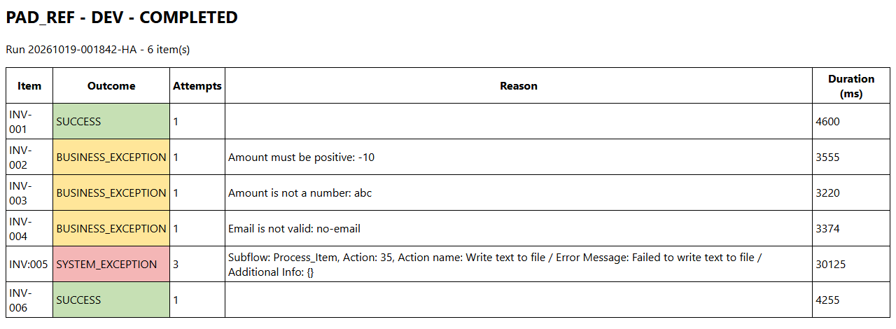 The run report of Main on the 6 demo items: 2 successes, 3 business exceptions, 1 system exception after 3 attempts

## Try it

From the path that asks the least to the one that asks the most. Stop at the one you need.

| Path | You create | Needs | Time |
|---|---|---|---|
| **[1. Rebuild the template](SETUP.md#1-rebuild-the-template)** Every subflow and variable in place, saved as a template of your environment. | 10 local subflows, 35 inputs, 35 outputs | PAD only | 90 min |
| **[2. A process from the template](SETUP.md#2-a-process-from-the-template)** **New › Flow from template**, then the regions the code marks `TEMPLATE`. | The regions marked TEMPLATE in 4 subflows | The template | Depends on your flow |

## Problem

Power Automate Desktop can now save a desktop flow **as a template**: in the designer, *Save as* with the type
*Template*, then *Publish*. *New › Flow from template* gives every new process its own copy, subflows, variables and
notes included ([Microsoft Learn](https://learn.microsoft.com/en-us/power-automate/desktop-flows/create-desktop-flow-templates),
version 2.72 or later). Until now each process started from an empty flow and wrote again its settings, its error
handling and its log, each in its own way, and a reviewer read every flow from scratch.

A template is only worth what it holds. This one holds what every process that works through a list of items needs,
tested, so that a new process writes only its business part.

## Solution

This first template of the lab draws on the public
[power-automate-desktop-framework](https://github.com/AgniusBartninkas/power-automate-desktop-framework) (PAD 2.57)
and rebuilds it for templates. `Main` is a state machine in five coloured regions (minimal state, guarded run, run
status, end, clean-up) that calls **11 local functions**. Three choices come first:

- **Local functions with declared inputs and outputs.** Each function receives its inputs (`in_loc_`), returns its
  outputs (`out_loc_`) and sees nothing else; `Tests` calls each one alone.
- **Numbered regions, one colour per role.** Collapsed, `Main` reads in 13 lines; a region number names the place to
  change (*region 2.1 of `Process_Item`*).
- **A note on every action.** Every action, condition, loop and region carries a note (*Add note*, at the top of its
  dialog), 525 in all: the technical reason, the business rule or what a learner should keep.

Each work item is one transaction with one outcome: `SUCCESS`, `BUSINESS_EXCEPTION` (the data breaks a rule, never
retried) or `SYSTEM_EXCEPTION` (an action failed: screenshot, applications closed, pause, retry). Around it: settings
in a CSV file overridden per environment, a log with levels, a CSV and HTML run report, a JSON summary for the cloud
flow, an optional Outlook notification and a `Tests` subflow of 24 cases. A process made from the template changes
what its code marks `TEMPLATE`, in four subflows.

**Techniques:** [A desktop flow template to start every process from](../../TECHNIQUES.md#desktop-flow-template) · [Local function with a contract](../../TECHNIQUES.md#local-function) · [Numbered regions, one colour per role](../../TECHNIQUES.md#coloured-regions) · [A note on every action](../../TECHNIQUES.md#action-notes) · [One outcome per work item, retries only for system exceptions](../../TECHNIQUES.md#transaction-outcomes) · [Errors returned, never thrown](../../TECHNIQUES.md#errors-as-outputs) · [Settings in a CSV file, overridden per environment](../../TECHNIQUES.md#settings-per-environment) · [A Tests subflow that calls every function](../../TECHNIQUES.md#test-subflow) · [Outlook draft instead of a send](../../TECHNIQUES.md#outlook-draft)

## What it adds to [power-automate-desktop-framework](https://github.com/AgniusBartninkas/power-automate-desktop-framework)

The reference was built for PAD 2.57, before desktop flow templates existed. What the template changes, topic by topic, the three choices above first:

| | [power-automate-desktop-framework](https://github.com/AgniusBartninkas/power-automate-desktop-framework) | Process framework template |
|---|---|---|
| Contracts | About 90 global variables shared by 29 global subflows | 11 local functions with declared inputs and outputs (68 in all); only `Main` and `Tests` are global |
| Reading the canvas | Regions without colours | Numbered regions, one colour per role; collapsed, `Main` reads in 13 lines |
| Explaining the flow | Comments | A note on every action, condition, loop and region (525), plus comments for the reader |
| Distribution | A flow to copy, or a solution to import | A desktop flow template: *New › Flow from template* |
| Dependencies | 8 utility desktop flows called with *Run desktop flow*, their ids replaced before the first run | None: every utility is a local function inside the template |
| Outcome of an item | One error message | `SUCCESS`, `BUSINESS_EXCEPTION` (never retried) or `SYSTEM_EXCEPTION` (retried after a recovery) |
| Resilience | Retries counted in the work item database | Retries per item with a screenshot, the applications closed and a pause; a circuit breaker after a number of system exceptions in a row; `in_glob_num_MaxItems` for a short run |
| Log | One child desktop flow run per log line | One file write per line, filtered by level; WARN and above also in the run log of Power Automate |
| Settings | JSON, Excel, database, SharePoint or Dataverse read by a child flow, each key read without a default | `Config.csv` editable in Excel: defaults in the flow, rows per environment, numbers checked, the file created when missing |
| Result of the run | `Output_IsSuccess` and `ErrorMessage` | The same, plus a JSON summary checked by reading it back, a CSV and HTML report and a screenshot per failed attempt |
| Name of the current step | An action that fails on purpose in each subflow, to read its name in the error | The step name is given to the log; nothing fails on purpose |
| Tests | None | `Tests`: 24 cases, one per function and per recovery path |

**Kept from [power-automate-desktop-framework](https://github.com/AgniusBartninkas/power-automate-desktop-framework):** the split between reading the work items and processing one item, the recovery of the applications before a retry, the error report sent to a person, one folder layout per project.

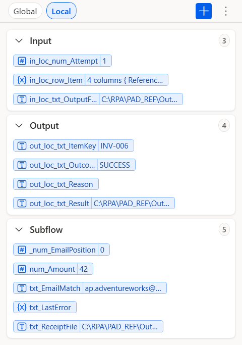 Local functions: Process_Item receives 3 inputs and returns 4 outputs (Variables pane, section Local, values of the last item)

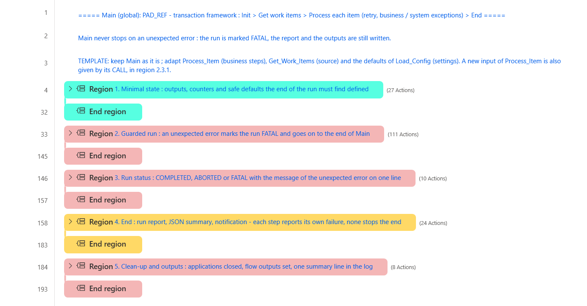 Coloured regions: Main collapsed, the whole run in 5 numbered regions

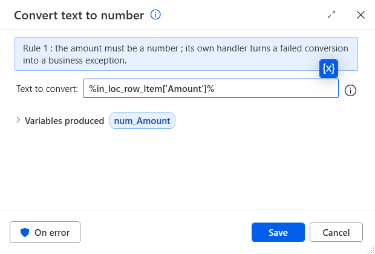 A note on every action: double-click an action, its note is at the top of the dialog

## Make a process from it

1. In the console, **New › Flow from template**: the name of your process, `PAD_REF` under **My templates**, **Create**. Every subflow, variable and note comes with it.
2. Change what the code marks `TEMPLATE`:

| Subflow | What to change |
|---|---|
| `Main` | keep Main as it is ; adapt Process_Item (business steps), Get_Work_Items (source) and the defaults of Load_Config (settings). A new input of Process_Item is also given by its CALL, in region 2.3.1. |
| `Load_Config` | add the default of every business setting in region 2, so the key exists even when Config.csv does not list it. |
| `Get_Work_Items` | replace region 3 by the real source (Excel, SQL, API, export of a business application), give region 1 the columns of that source and remove the demo part of region 2 ; keep one row per item. |
| `Process_Item` | replace regions 2.1 (business rules) and 2.2 (application steps) by the real process, and the key column read in region 1 ; keep the rest of regions 1, 2 and 3. |

3. Run `Tests`, then `Main`. Step by step: [A process from the template](SETUP.md#2-a-process-from-the-template).

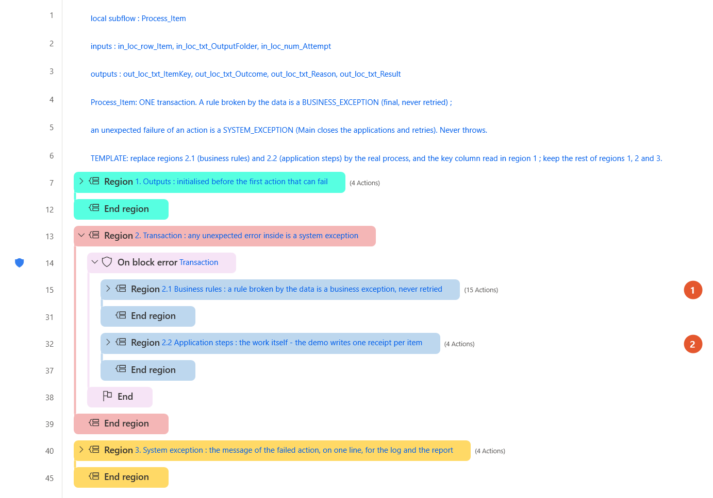 Process_Item: marker 1 on region 2.1 (business rules), marker 2 on region 2.2 (application steps)

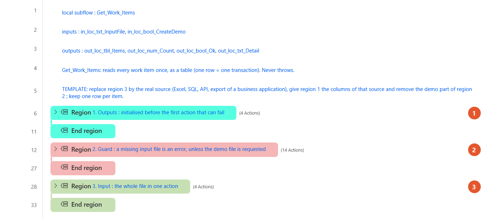 Get_Work_Items: markers on regions 1 (columns), 2 (demo part) and 3 (the source)

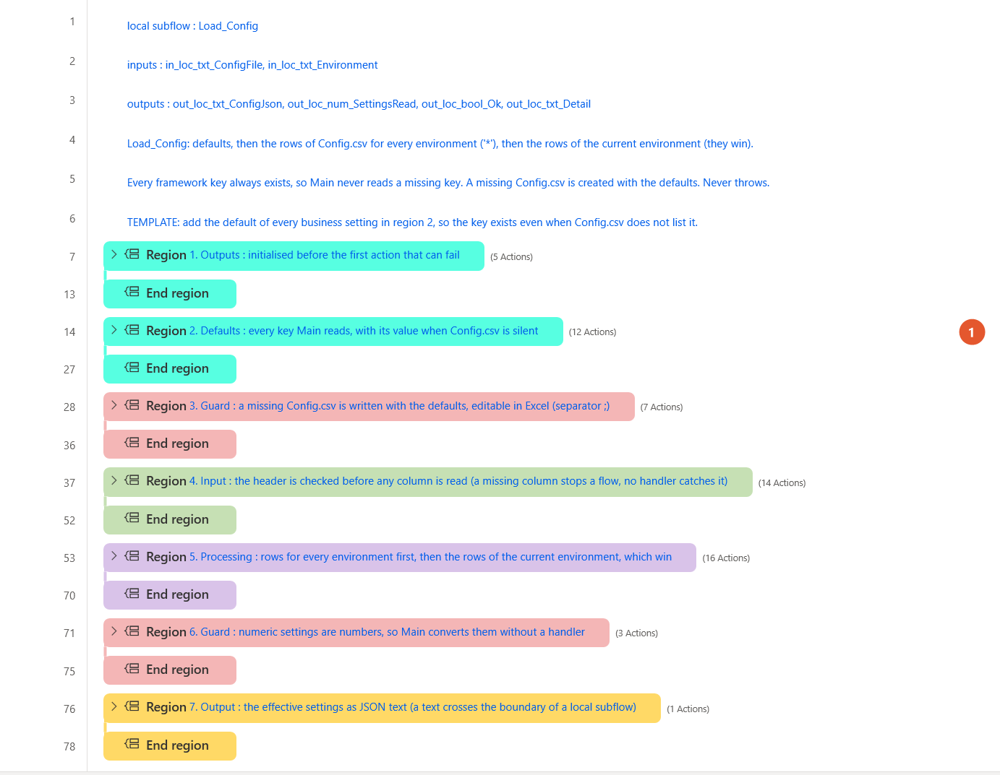 Load_Config: the marker shows region 2, the defaults of the settings

Inputs and outputs of the flow:

| Inputs | Type | Description | Example |
|---|---|---|---|
| `in_glob_num_MaxItems` | Number | 0 = every item; n = stop after n items (a short run) | `0` |
| `in_glob_txt_Environment` | Text | Selects the rows of Config.csv: DEV, TEST, PROD or any name | `DEV` |
| `in_glob_txt_LogLevel` | Text | Lowest level written to the log: DEBUG, INFO, WARN, ERROR or FATAL | `INFO` |
| `in_glob_txt_ProcessName` | Text | Name of the process in the log, the report and the notification | `PAD_REF` |
| `in_glob_txt_ProjectFolder` | Text | Root of the folders Config, Input, Output, Logs, Evidence and Reports, created when missing | `C:\RPA\PAD_REF` |

| Outputs | Type | Description | Example |
|---|---|---|---|
| `out_glob_bool_Success` | Boolean | True when the run reached COMPLETED; items in exception do not make it fail | `True` |
| `out_glob_txt_ErrorMessage` | Text | Why a FATAL or ABORTED run stopped, on one line; empty after a COMPLETED run | `Input file not found: C:\RPA\PAD_REF\Input\work-items.csv` |
| `out_glob_txt_RunSummary` | Text | JSON: run id, process, environment, status, counts, retries, duration, report, error | `{"runId": "20261019-001842-HA", "status": "COMPLETED", "itemsRead": 6, ...}` |

The 11 local functions: each one receives its inputs, returns its outputs and sees nothing else.

| Function | Inputs | Outputs | Role |
|---|---|---|---|
| [`Verify`](flow/3-Verify.txt) | 5 | 1 | Writes one PASS or FAIL line of Tests to the report. |
| [`Init_Run`](flow/4-Init_Run.txt) | 2 | 8 | Creates the project folders (missing parents included) and builds the run id and the name of the daily log file. |
| [`Write_Log`](flow/5-Write_Log.txt) | 6 | 1 | One line per event, filtered by level; WARN and above also go to the run log of Power Automate. |
| [`Load_Config`](flow/6-Load_Config.txt) | 2 | 4 | Defaults, then the rows of Config.csv for every environment, then the rows of the current environment; numbers checked; returned as JSON. |
| [`Get_Work_Items`](flow/7-Get_Work_Items.txt) | 2 | 4 | Reads every work item once, as a table (one row = one transaction); writes the demo file when asked. |
| [`Process_Item`](flow/8-Process_Item.txt) | 3 | 4 | One transaction: the business rules, the application steps and the outcome of the item. |
| [`Take_Evidence`](flow/9-Take_Evidence.txt) | 4 | 2 | A screenshot named after the run, the item and the attempt. |
| [`Close_Applications`](flow/10-Close_Applications.txt) | 1 | 2 | Closes the running processes of a list: at start, before a retry and at the end. |
| [`Write_Run_Report`](flow/11-Write_Run_Report.txt) | 4 | 4 | The result of every item as a CSV file and as an HTML page. |
| [`Send_Notification`](flow/12-Send_Notification.txt) | 5 | 2 | The HTML report by Outlook, as a draft or sent; NONE turns it off. |
| [`To_Json_Text`](flow/13-To_Json_Text.txt) | 1 | 1 | Escapes a text for a JSON value. |

## How it works

```mermaid
flowchart TB
  subgraph Main["<b>Main</b> · main"]
    direction LR
    Main_1["1. Minimal state "]
    style Main_1 fill:#57FFE1,stroke:#57606a,color:#1f2328
    Main_2["2. Guarded run "]
    style Main_2 fill:#F4B6B6,stroke:#57606a,color:#1f2328
    Main_1 --> Main_2
    Main_3["3. Run status "]
    style Main_3 fill:#F4B6B6,stroke:#57606a,color:#1f2328
    Main_2 --> Main_3
    Main_4["4. End "]
    style Main_4 fill:#FFD966,stroke:#57606a,color:#1f2328
    Main_3 --> Main_4
    Main_5["5. Clean-up and outputs "]
    style Main_5 fill:#F4B6B6,stroke:#57606a,color:#1f2328
    Main_4 --> Main_5
  end
  subgraph Init_Run["<b>Init_Run</b> · local function"]
    direction LR
    Init_Run_1["1. Outputs "]
    style Init_Run_1 fill:#57FFE1,stroke:#57606a,color:#1f2328
    Init_Run_2["2. Guard "]
    style Init_Run_2 fill:#F4B6B6,stroke:#57606a,color:#1f2328
    Init_Run_1 --> Init_Run_2
    Init_Run_3["3. Run id and log file "]
    style Init_Run_3 fill:#D9C3E9,stroke:#57606a,color:#1f2328
    Init_Run_2 --> Init_Run_3
    Init_Run_4["4. Folders "]
    style Init_Run_4 fill:#FFD966,stroke:#57606a,color:#1f2328
    Init_Run_3 --> Init_Run_4
  end
  subgraph Write_Log["<b>Write_Log</b> · local function"]
    direction LR
    Write_Log_1["1. Output and level ranks "]
    style Write_Log_1 fill:#57FFE1,stroke:#57606a,color:#1f2328
    Write_Log_2["2. Guard "]
    style Write_Log_2 fill:#F4B6B6,stroke:#57606a,color:#1f2328
    Write_Log_1 --> Write_Log_2
    Write_Log_3["3. Output "]
    style Write_Log_3 fill:#FFD966,stroke:#57606a,color:#1f2328
    Write_Log_2 --> Write_Log_3
  end
  subgraph Load_Config["<b>Load_Config</b> · local function"]
    direction LR
    Load_Config_1["1. Outputs "]
    style Load_Config_1 fill:#57FFE1,stroke:#57606a,color:#1f2328
    Load_Config_2["2. Defaults "]
    style Load_Config_2 fill:#57FFE1,stroke:#57606a,color:#1f2328
    Load_Config_1 --> Load_Config_2
    Load_Config_3["3. Guard "]
    style Load_Config_3 fill:#F4B6B6,stroke:#57606a,color:#1f2328
    Load_Config_2 --> Load_Config_3
    Load_Config_4["4. Input "]
    style Load_Config_4 fill:#C6E0B4,stroke:#57606a,color:#1f2328
    Load_Config_3 --> Load_Config_4
    Load_Config_5["5. Processing "]
    style Load_Config_5 fill:#D9C3E9,stroke:#57606a,color:#1f2328
    Load_Config_4 --> Load_Config_5
    Load_Config_6["6. Guard "]
    style Load_Config_6 fill:#F4B6B6,stroke:#57606a,color:#1f2328
    Load_Config_5 --> Load_Config_6
    Load_Config_7["7. Output "]
    style Load_Config_7 fill:#FFD966,stroke:#57606a,color:#1f2328
    Load_Config_6 --> Load_Config_7
  end
  subgraph Get_Work_Items["<b>Get_Work_Items</b> · local function"]
    direction LR
    Get_Work_Items_1["1. Outputs "]
    style Get_Work_Items_1 fill:#57FFE1,stroke:#57606a,color:#1f2328
    Get_Work_Items_2["2. Guard "]
    style Get_Work_Items_2 fill:#F4B6B6,stroke:#57606a,color:#1f2328
    Get_Work_Items_1 --> Get_Work_Items_2
    Get_Work_Items_3["3. Input "]
    style Get_Work_Items_3 fill:#C6E0B4,stroke:#57606a,color:#1f2328
    Get_Work_Items_2 --> Get_Work_Items_3
  end
  subgraph Process_Item["<b>Process_Item</b> · local function"]
    direction LR
    Process_Item_1["1. Outputs "]
    style Process_Item_1 fill:#57FFE1,stroke:#57606a,color:#1f2328
    Process_Item_2["2. Transaction "]
    style Process_Item_2 fill:#F4B6B6,stroke:#57606a,color:#1f2328
    Process_Item_1 --> Process_Item_2
    Process_Item_3["3. System exception "]
    style Process_Item_3 fill:#FFD966,stroke:#57606a,color:#1f2328
    Process_Item_2 --> Process_Item_3
  end
  subgraph Take_Evidence["<b>Take_Evidence</b> · local function"]
    direction LR
    Take_Evidence_1["1. Outputs "]
    style Take_Evidence_1 fill:#57FFE1,stroke:#57606a,color:#1f2328
    Take_Evidence_2["2. Output "]
    style Take_Evidence_2 fill:#FFD966,stroke:#57606a,color:#1f2328
    Take_Evidence_1 --> Take_Evidence_2
  end
  subgraph Close_Applications["<b>Close_Applications</b> · local function"]
    direction LR
    Close_Applications_1["1. Outputs "]
    style Close_Applications_1 fill:#57FFE1,stroke:#57606a,color:#1f2328
    Close_Applications_2["2. Guard "]
    style Close_Applications_2 fill:#F4B6B6,stroke:#57606a,color:#1f2328
    Close_Applications_1 --> Close_Applications_2
    Close_Applications_3["3. Processing "]
    style Close_Applications_3 fill:#D9C3E9,stroke:#57606a,color:#1f2328
    Close_Applications_2 --> Close_Applications_3
  end
  subgraph Write_Run_Report["<b>Write_Run_Report</b> · local function"]
    direction LR
    Write_Run_Report_1["1. Outputs "]
    style Write_Run_Report_1 fill:#57FFE1,stroke:#57606a,color:#1f2328
    Write_Run_Report_2["2. Guard "]
    style Write_Run_Report_2 fill:#F4B6B6,stroke:#57606a,color:#1f2328
    Write_Run_Report_1 --> Write_Run_Report_2
    Write_Run_Report_3["3. Processing "]
    style Write_Run_Report_3 fill:#D9C3E9,stroke:#57606a,color:#1f2328
    Write_Run_Report_2 --> Write_Run_Report_3
    Write_Run_Report_4["4. Output "]
    style Write_Run_Report_4 fill:#FFD966,stroke:#57606a,color:#1f2328
    Write_Run_Report_3 --> Write_Run_Report_4
  end
  subgraph Send_Notification["<b>Send_Notification</b> · local function"]
    direction LR
    Send_Notification_1["1. Outputs "]
    style Send_Notification_1 fill:#57FFE1,stroke:#57606a,color:#1f2328
    Send_Notification_2["2. Guards "]
    style Send_Notification_2 fill:#F4B6B6,stroke:#57606a,color:#1f2328
    Send_Notification_1 --> Send_Notification_2
    Send_Notification_3["3. Output "]
    style Send_Notification_3 fill:#FFD966,stroke:#57606a,color:#1f2328
    Send_Notification_2 --> Send_Notification_3
  end
  subgraph To_Json_Text["<b>To_Json_Text</b> · local function"]
    direction LR
    To_Json_Text_1["1. Processing "]
    style To_Json_Text_1 fill:#D9C3E9,stroke:#57606a,color:#1f2328
  end
  Main == "CALL · 1 in · 2 out" ==> Close_Applications
  Main == "CALL · 2 in · 4 out" ==> Get_Work_Items
  Main == "CALL · 2 in · 8 out" ==> Init_Run
  Main == "CALL · 2 in · 4 out" ==> Load_Config
  Main == "CALL · 3 in · 4 out" ==> Process_Item
  Main == "CALL · 5 in · 2 out" ==> Send_Notification
  Main == "CALL · 4 in · 2 out" ==> Take_Evidence
  Main == "CALL · 1 in · 1 out" ==> To_Json_Text
  Main == "CALL · 6 in · 1 out" ==> Write_Log
  Main == "CALL · 4 in · 4 out" ==> Write_Run_Report
```

`Main`, region by region:

1. **Minimal state**: outputs, counters and safe defaults the end of the run must find defined
2. **Guarded run**: an unexpected error marks the run FATAL and goes on to the end of Main
3. **Run status**: COMPLETED, ABORTED or FATAL with the message of the unexpected error on one line
4. **End**: run report, JSON summary, notification - each step reports its own failure, none stops the end
5. **Clean-up and outputs**: applications closed, flow outputs set, one summary line in the log

## Example: invoice reminders made from the template

The accounting team keeps a workbook of unpaid invoices (columns Invoice, Customer, Amount, Email, Status). Every
morning, each invoice marked *To remind* must get a payment reminder, saved as an Outlook draft that a person reads
before it leaves. A paid invoice, an amount that is not a number or a wrong e-mail address must be listed in the
report, never reminded. The flow `Invoice_Reminders` was made with *New › Flow from template*; these are the only
places that changed:

| Subflow | Region | What changed |
|---|---|---|
| `Get_Work_Items` | 1 | The columns of the table: Invoice, Customer, Amount, Email, Status. |
| `Get_Work_Items` | 2 | The demo part removed: a missing workbook is an error. |
| `Get_Work_Items` | 3 | The workbook read in one action: *Launch Excel* hidden and read only, *Read from Excel worksheet*, *Close Excel*, all inside the function. |
| `Process_Item` | 1 | The key of the item read from the column Invoice. |
| `Process_Item` | 2.1 | A first rule: only the status To remind. The rules on the amount and the e-mail are kept. |
| `Process_Item` | 2.2 | The demo receipt replaced by *Launch Outlook* and *Send email message through Outlook* with *Save as draft*; a new input `in_loc_txt_Account` for the Outlook account. |
| `Main` | 2.3.1 | The CALL of `Process_Item` gives the new input, from the setting `NotifyAccount`. |
| `Tests` | 1, 5 and 6 | Five test invoices, a test workbook written then read, one case per rule. |
| `Config.csv` | - | `InputFile` = the workbook, `CreateDemoInput` = False, `ProcessesToClose` = EXCEL, `NotifyChannel` = OUTLOOK_DRAFT (OUTLOOK_SEND on a PROD row), `NotifyTo` and `NotifyAccount`. |

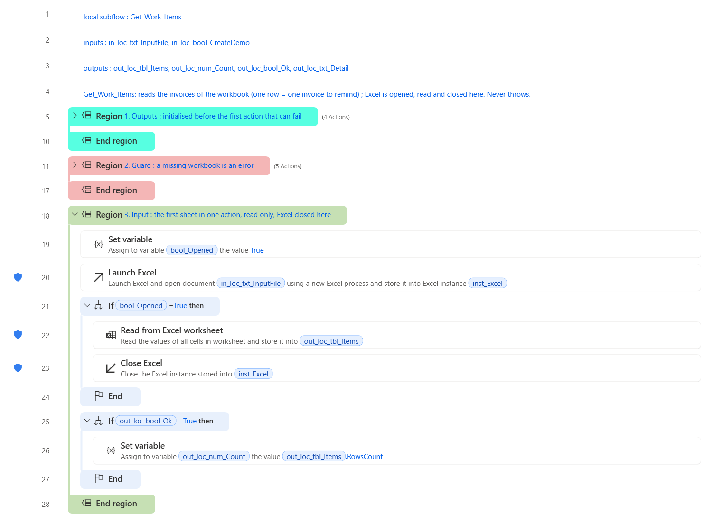 Get_Work_Items of the example: region 3 reads the workbook with Excel and closes it

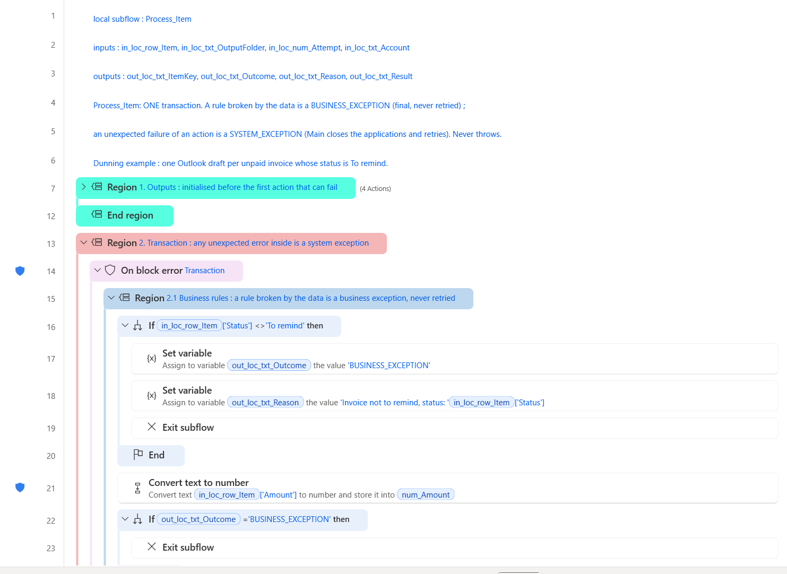 Process_Item of the example, region 2.1: the new rule on the status comes first

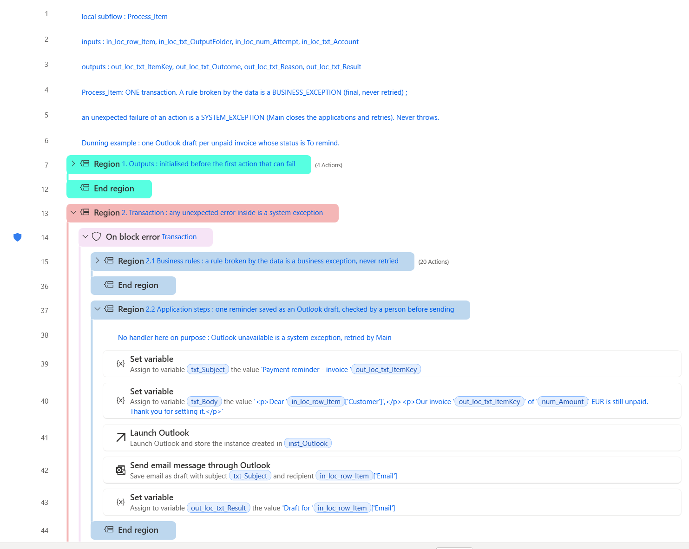 Process_Item of the example, region 2.2: the reminder saved as an Outlook draft

**Result.**

- `Tests` of the example: 24 PASS, 0 FAIL (2026-10-18, 202 s for the last run).
- `Main` on a workbook of 5 invoices: COMPLETED, 2 reminders saved as Outlook drafts, 3 business exceptions (one paid, one amount `abc`, one address `no-email`), the run report saved as a draft too. Nothing was sent.
- About 5.5 s per reminder in the designer, Outlook included (2026-10-18).

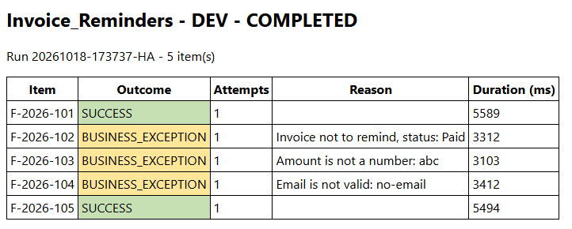 The run report of the example: 2 reminders, 3 invoices listed with the reason

**Benefits.**

- Only the business part was written: the regions in the table. The settings, the retries, the screenshots, the log, the run report and the notification came from the template, unchanged.
- The same folders, log and report as every other process made from the template: the support team reads them all the same way.
- A person reads each reminder before it leaves: the robot prepares, the accountant decides.
- Each rule is tested before a run: five test invoices, one case per rule.

## Performance

- Tested run of 2026-10-19 in the designer (PAD 2.73.155): `Main` on the 6 demo items ended COMPLETED in 148 s - 2 successes, 3 business exceptions, 1 system exception after 3 attempts.
- About 3 to 5 s per item in the designer: one call of `Process_Item` and one to three lines of log. The item in system exception took 30 s: three attempts, each with a screenshot, the recovery and a pause of 2 s.
- `Tests`: 24 cases in 151 s (2026-10-19).
- Every time was measured in the designer, which draws each action on screen. A run from the console or from a cloud flow was not measured.

## Limits

- Templates need PAD 2.72 or later; tested on 2.73.155. Only *My templates* was tested: sharing the template with other makers was not.
- A flow made from the template is a copy: it does not follow later changes of the template.
- An application instance (Excel, a browser, Outlook) cannot cross the boundary of a local function: open, use and close it in the function that does the work, as `Get_Work_Items` of the example does with Excel and `Send_Notification` with Outlook.
- `ProcessesToClose` closes every process of that name, windows of the user included. On a PC that is also used by a person, list only what the robot opens.
- Not proven by `Tests`: an Outlook message drafted or sent by `Send_Notification` (the channel is `NONE` in the demo; the example below drafted reminders and its run report), a retry that succeeds after a passing failure, a FATAL run, a run from the console or from a cloud flow.
- The work items are read once per run from one list. Power Automate work queues are not used; replacing the loop of `Main` by a work queue was not tested.
- The notes show in the dialog of each action, not on the canvas.
- `out_glob_txt_ErrorMessage` can carry data of an item: mark it as sensitive when the items hold personal data.

## Files

| Subflow | Scope | Lines | Role |
|---|---|---|---|
| [`Main`](flow/1-Main.txt) | Main | 193 | The run: minimal state, guarded run (init, work items, one transaction per item with retries), run status, end (report, summary, notification), clean-up and outputs. |
| [`Tests`](flow/2-Tests.txt) | Global | 190 | 24 cases: each function and each recovery path called with fixed inputs, one PASS or FAIL line per case in a report. Run it with Run from here on its first action. *(optional)* |
| [`Verify`](flow/3-Verify.txt) | Local | 12 | Writes one PASS or FAIL line of Tests to the report. *(optional)* |
| [`Init_Run`](flow/4-Init_Run.txt) | Local | 48 | Creates the project folders (missing parents included) and builds the run id and the name of the daily log file. |
| [`Write_Log`](flow/5-Write_Log.txt) | Local | 33 | One line per event, filtered by level; WARN and above also go to the run log of Power Automate. |
| [`Load_Config`](flow/6-Load_Config.txt) | Local | 78 | Defaults, then the rows of Config.csv for every environment, then the rows of the current environment; numbers checked; returned as JSON. |
| [`Get_Work_Items`](flow/7-Get_Work_Items.txt) | Local | 33 | Reads every work item once, as a table (one row = one transaction); writes the demo file when asked. |
| [`Process_Item`](flow/8-Process_Item.txt) | Local | 45 | One transaction: the business rules, the application steps and the outcome of the item. |
| [`Take_Evidence`](flow/9-Take_Evidence.txt) | Local | 12 | A screenshot named after the run, the item and the attempt. |
| [`Close_Applications`](flow/10-Close_Applications.txt) | Local | 26 | Closes the running processes of a list: at start, before a retry and at the end. |
| [`Write_Run_Report`](flow/11-Write_Run_Report.txt) | Local | 34 | The result of every item as a CSV file and as an HTML page. |
| [`Send_Notification`](flow/12-Send_Notification.txt) | Local | 37 | The HTML report by Outlook, as a draft or sent; NONE turns it off. |
| [`To_Json_Text`](flow/13-To_Json_Text.txt) | Local | 9 | Escapes a text for a JSON value. |

- Output of the test run, in [`expected/`](expected/): `run-report.csv`, `tests-report.txt`

## Tested on

| PAD version | Date | Path | Result |
|---|---|---|---|
| 2.73.155 | 2026-10-18 | Rebuild, Save as Template, Publish, then New › Flow from template | Pass |
| 2.73.155 | 2026-10-18 | A process from the template: the invoice reminders example | Pass |
| 2.73.155 | 2026-10-19 | Full flow: Tests 24 / 24, then Main | Pass |

Authors: Anne (AI agent), HyperAutomatisation · [Changelog](CHANGELOG.md) · [Report a problem](https://github.com/anne-automates/pad-samples/issues/new?template=sample-does-not-work.yml&title=%5Bprocess-framework-template%5D+)
